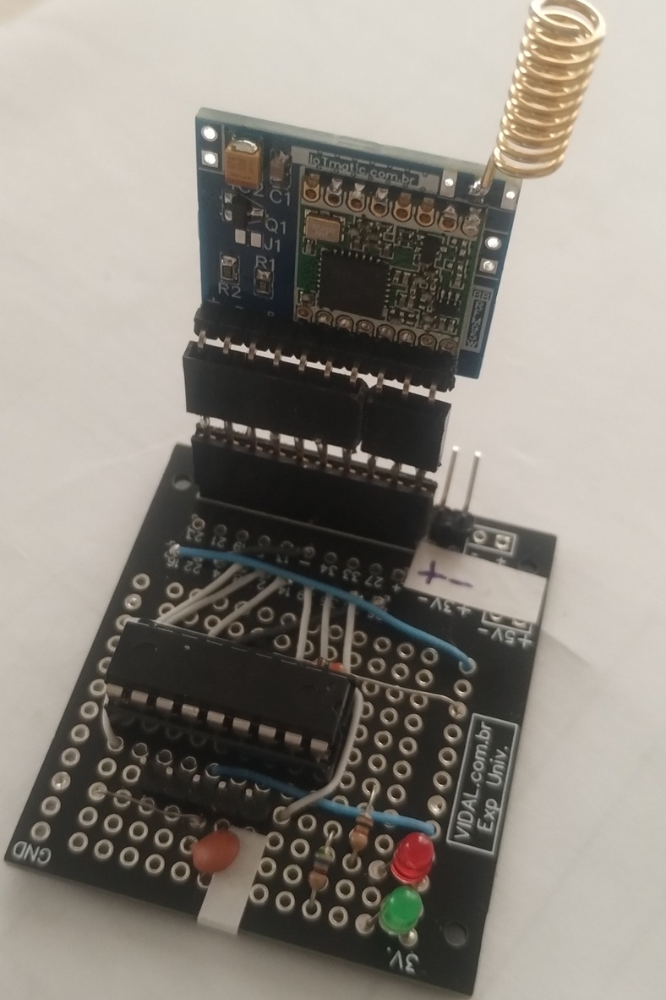

# FW__PIC16F1827__PingPong_RFM_Zilia_Smart

Esta pasta contém o firmware para **PIC16F1827** utilizado no teste de comunicação Ping-Pong LoRa com a placa **BB_RFM95W** na plataforma Zilia Smart.

## 📌 Descrição

*PROJETO COMPLETO no ambiente MPLABX*

## 🛠️ Compilação e Gravação

* **Placa Alvo:** Placa customizada PIC16F1827
* **Módulo RF:** RFM95W (via breakout BB_RFM95W)

# Protótipo com PIC16F1827

