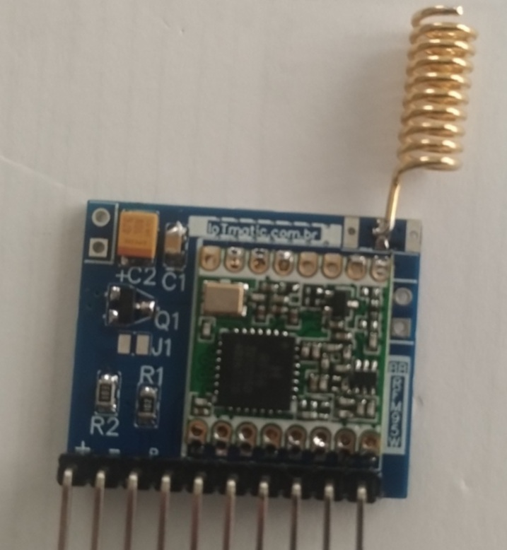
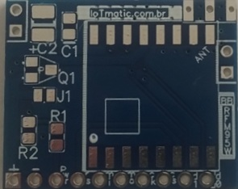
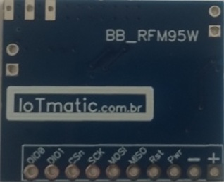

# BB_RFM95W - Breakout Board para Módulo LoRa RFM95W

A **BB_RFM95W** é uma placa de expansão (*breakout board*) desenvolvida pela **[IoTmatic.com.br](https://iotmatic.com.br)** para facilitar a integração e prototipagem com o consagrado módulo LoRa **RFM95W**. 

Ela foi projetada para acelerar o desenvolvimento desde a fase de protótipos em protoboard até a aplicação em produtos finais, eliminando a necessidade de soldar fiação complexa (*dead-bug/jumpers*) ou projetar placas customizadas para testes rápidos.

---

## 📸 Visão Geral da Placa

| Vista Superior (Top) | Vista Inferior (Bottom) |
| :---: | :---: |
|  |  |

---

## ✨ Destaques e Recursos

- **Controle de Alimentação Integrado (pFET):** Circuito de comutação On/Off via P-MOSFET acionado pelo pino `Pwr`, permitindo desligar completamente o módulo RFM95W para alcançar consumo de energia ultra-baixo (*ultra-low power sleep*).
- **Conexão de Antena Otimizada:** Ponto de solda para antena helicoidal/fio rígido e malha de terra (*ground plane*) dimensionada para máxima eficiência de RF.
- **Pinagem Enxuta e Eficiente:** Expõe apenas os pinos essenciais. Além dos pinos de alimentação e SPI/Controle, inclui os pinos **DIO0** e **DIO1**, cobrindo 100% dos requisitos da maioria das pilhas de protocolo **LoRaWAN** (ex: LMIC) e comunicações **LoRa P2P**.
- **Footprint Amigável:** Espaçamento ideal de pinos para uso direto em protoboard ou integração via conectores fêmea/macho.

---

## 📌 Descrição da Pinagem (Header Principal)

Os pinos estão alinhados na borda inferior da placa para facilitar o acesso:

| Serigrafia | Função | Descrição |
| :---: | :---: | :--- |
| **`+`** | VCC | Alimentação positiva do circuito ($3.3\text{ V}$). |
| **`-`** | GND | Terra / Referência de alimentação ($0\text{ V}$). |
| **`Pwr`** | Power Control | Controle do MOSFET (P-FET). Sinal lógico para ligar/desligar a alimentação do RFM95W. |
| **`Rst`** | Reset | Pino de Reset do RFM95W (ativo em nível baixo). |
| **`MISO`** | SPI MISO | Master In Slave Out (comunicação SPI). |
| **`MOSI`** | SPI MOSI | Master Out Slave In (comunicação SPI). |
| **`SCK`** | SPI SCK | Clock da comunicação SPI. |
| **`CSn`** | SPI NSS/CS | Chip Select (ativo em nível baixo). |
| **`DIO1`** | Interrupção 1 | Interrupção LoRa (utilizado em LoRaWAN para timeouts e eventos secundários). |
| **`DIO0`** | Interrupção 0 | Interrupção principal LoRa (TxDone, RxDone). |

---

## 💡 Aplicações Típicas

1. **Nós Sensores LoRaWAN (End Devices):** Compatível com bibliotecas populares como *MCCI LoRaWAN LMIC library*, utilizando o mapeamento simples `DIO0` + `DIO1`.
2. **Comunicação LoRa P2P (Ponto a Ponto):** Conexão simplificada entre dois nós para transmissão de dados de longa distância sem infraestrutura de rede.
3. **Protótipos de Baixo Consumo (Battery-Powered):** Utilizando o controle no pino `Pwr` para cortar totalmente a corrente do módulo quando não estiver transmitindo ou ouvindo.

---

## 🔧 Especificações Técnicas

- **Módulo Compatível:** HopeRF RFM95W (868/915 MHz)
- **Interface de Comunicação:** SPI
- **Tensão de Operação:** $3.3\text{ V}$ (atenção: as linhas de I/O operam em níveis lógicos de $3.3\text{ V}$)
- **Desenvolvido por:** [IoTmatic.com.br](https://iotmatic.com.br)

---

## 📄 Licença

Este projeto é de código/hardware aberto. Sinta-se à vontade para clonar, modificar e contribuir!